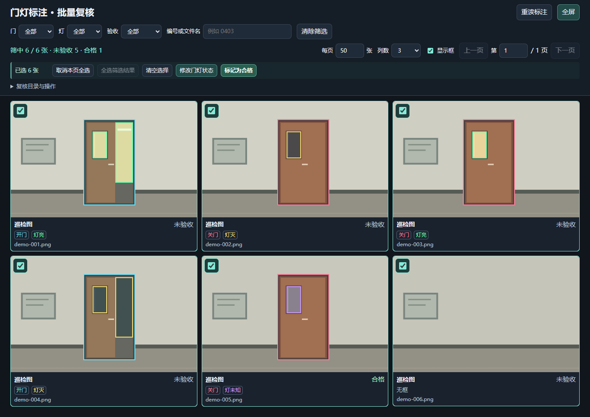
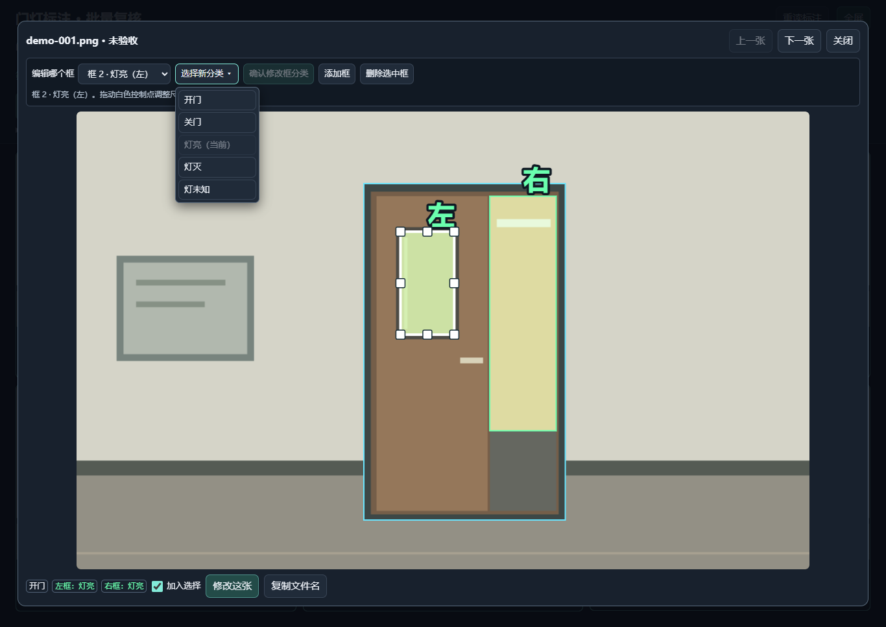
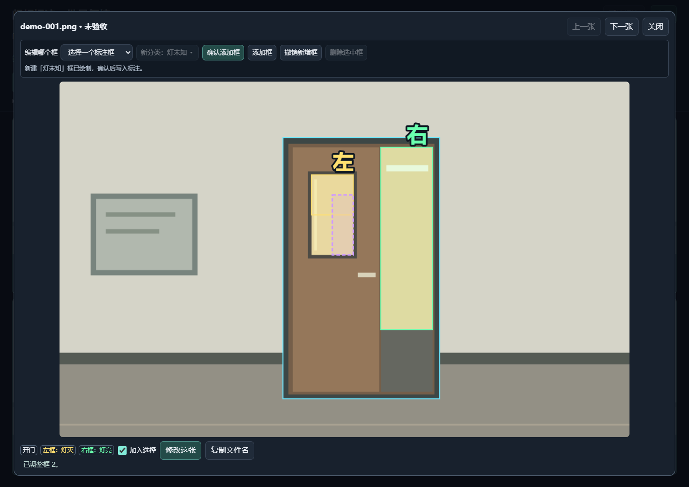

# 门灯标注协作工具

在网页上按门、灯和验收状态筛选 X-AnyLabeling 数据，批量复核分类，或逐张修订矩形框。网页和 X-AnyLabeling 读取**同一个目录里的图片与同名 JSON**。确认保存后直接更新 JSON，原标注会先备份。

这个仓库提供标注复核工具、合成演示和使用说明。YOLO 的训练和批量模型推理由独立流程完成。

## 在 Windows 上启动

使用 Python 3.12（已在 Python 3.12.10 上验证）和 Chrome 或 Edge。后端只使用 Python 标准库，网页无需安装依赖或构建。打开 PowerShell 并进入项目目录：

```powershell
py -3.12 -m venv --without-pip .venv
.\.venv\Scripts\python.exe -X utf8 demo.py
.\启动复核.cmd "data\演示\图像" --port 18768
```

访问 [合成演示](http://127.0.0.1:18768/)。演示脚本生成 6 张示意图和标注；重复运行会保留已有的演示标注。`Ctrl+C` 可停止服务。

使用实际数据时，把图片和 JSON 放在 `data/图像/`，双击 `启动复核.cmd`，访问 [本机复核页](http://127.0.0.1:8768/)。也可指定已有的图片目录与端口：

```powershell
.\启动复核.cmd "E:\巡检复核\图像" --port 8768
```

启动脚本依次使用 `DOORLIGHT_PYTHON` 指定的 Python、项目 `.venv`、Windows 的 `py -3` 或 `python`。运行时只监听 `127.0.0.1`，用于本机浏览器与本机桌面软件协作。

## X-AnyLabeling 打开哪个目录？

在 X-AnyLabeling 里点 **打开目录**，选择**实际存放图片和对应 JSON 的那一级**。新项目默认是 `data/图像`；演示是 `data/演示/图像`。例如 `001.jpg` 和 `001.json` 应并排放在同一目录。如果桌面软件另外设置了标注输出目录，请把它和网页对齐。网页展开「复核目录与操作」可检查当前读取路径。

| 修改的一端 | 在另一端怎样看到修改 |
| --- | --- |
| X-AnyLabeling 保存 | 回到网页点「重读标注」。服务检查文件变更，一般只重解析修改过的 JSON，并返回变化的记录。 |
| 网页点击确认 | X-AnyLabeling 重新载入这张图后再继续编辑。若软件仍打开着该图，先重新载入，避免保存旧副本。 |

尽量在同一时间只用一个工具编辑同一张图。网页会检查 JSON 版本，发现文件变化会跳过写入并提示重读。备份目录在所选图片目录的上一级，名称形如 `网页单框修订备份_…`。需要恢复时，先停止编辑，再把备份里对应的 JSON 复制回图片目录，并在两端重新载入。

## 批量复核与单图修订

1. **批量筛选。** 选择门、灯和验收状态，或按文件名搜索。默认每页 50 张，可设为 1–150 张；可自定义列数、显示框和全屏。页面默认筛「未验收」，查看已验收图片时，把「验收」改为「全部」。
2. **批量改分类或验收。** 勾选图片、用 `Shift` 连选、全选本页或全选筛选结果。门分类只修改恰好有一个门框的图片；灯分类可改左框、右框或全部，左/右要求恰好有两个可区分的灯框。用「标记为合格」设置 `checked: true`，而改框和改分类会保留原验收状态。



3. **修订原有框。** 点开图片后点击框，或从「编辑哪个框」选择。双击框可打开分类菜单，拖白色控制点调整边缘，确认后写回原图坐标。分类和尺寸可以一起保存。按 `Delete` 或点「删除选中框」，再确认删除。点击图片弹窗外或按 `Esc` 可退出。



4. **增加漏框。** 点「添加框」，选择类别，再在图片上从一个角拖到对角。检查虚线预览，点「确认添加框」保存；可以取消或重画。



当前五类：`door_open` 开门、`door_closed` 关门、`light_on` 灯亮、`light_off` 灯灭、`light_unknown` 灯未知。优先标清目标主门和有效的室内观察区；开门先看门缝或门洞，证据不足再看门窗；灯光无法可靠判断时保留未知。空框图片也能验收，是否用于训练由数据集筛选规则另行确定。网页新建框的 `group_id` 默认为空，如有训练分组要求，需单独核对。

## 项目结构与检查

| 路径 | 用途 |
| --- | --- |
| `web/复核.html`、`web/server.py` | 网页、HTTP 接口、目录索引与标注保存。 |
| `启动复核.cmd`、`demo.py` | Windows 启动入口和合成数据生成脚本。 |
| `docs/`、`tests/` | 使用截图、[代码结构](docs/复核页代码结构.md)和接口集成测试。 |
| `data/`、`.venv/` | 本机图片、标注、历史归档及 Python 环境，已由 Git 忽略。 |

运行检查：`py -3.12 -m unittest discover -s tests -v`。测试使用临时合成数据，覆盖标注写回和备份、左/右批量改灯、验收、外部修改重读以及拒绝过期的编辑请求。
